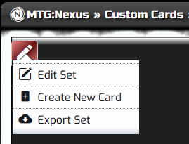
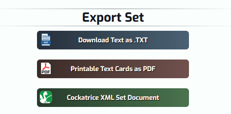
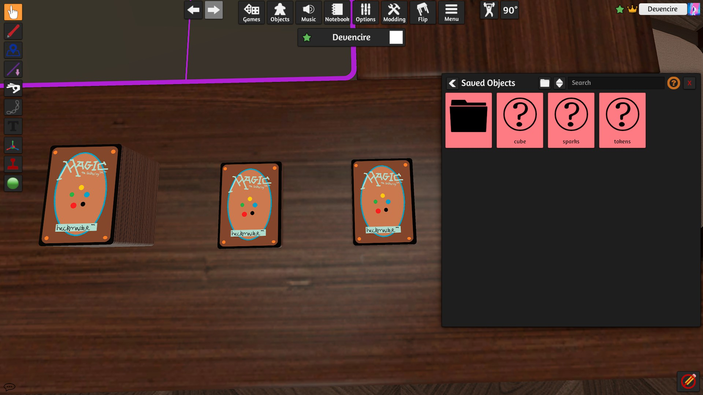
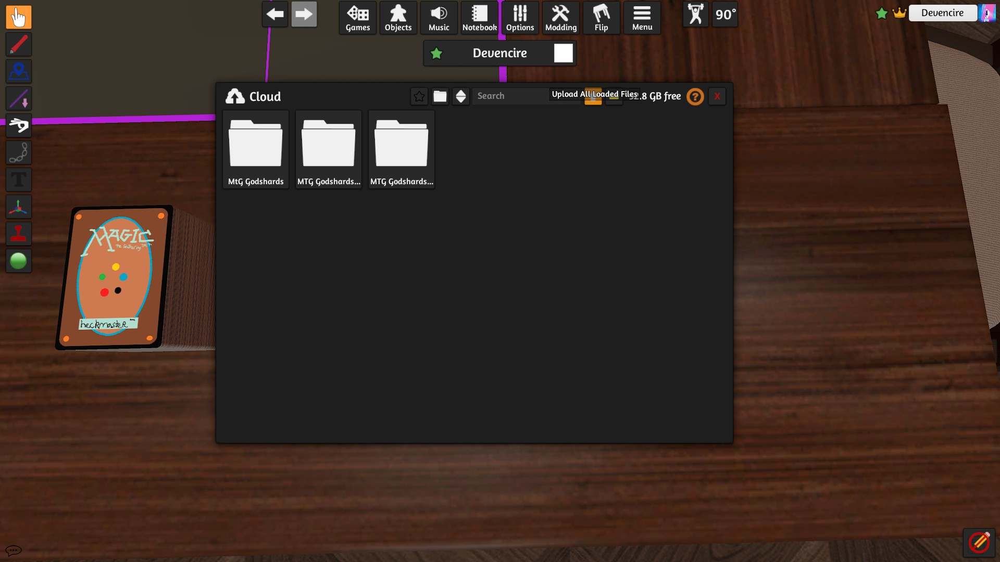

# MtG Nexus Import

This is an unreasonably specialised tool for taking the Cockatrice XML Set Document export from a [MtGNexus custom set](https://www.mtgnexus.com/customcards/) and creating

* card sheets of the shape Tabletop Simulator expects (10x7, double resolution to make text more readable)
  * a separate sheet for double-sided cards
  * a separate sheet for tokens (cards with Token in their type)
* JSON files of 'saved objects' for use with Tabletop Simulator
  * a deck with a Lua script attached for spawning 'booster packs'
    * This is super specific to my friend's set and its booster pack rules, for anything else the Lua would need some hacking
  * a deck of the backs of double-sided cards
  * a deck of the tokens

### How to use

* [Install `uv`](https://docs.astral.sh/uv/getting-started/installation/)
* Download the Cockatrice XML Set Document from MTGNexus

* In a shell, `uv run main.py`
* Copy the `.json` files from `output_data/` into `Documents/My Games/Tabletop Simulator/Content/SavedObjects` (or `~/.local/share/Tabletop Simulator/Saves/Saved Objects` if you're cool enough to be on Linux)
* Start a singleplayer Tabletop Simulator game with a table you like
  * [this MTG 6 player table seems good](https://steamcommunity.com/sharedfiles/filedetails/?id=2293586471)
  * there's a save in `extras/tabletop_simulator_save.json` which is a stripped-down version of the above table
* Drag all three decks from Saved Objects onto the table

* Modding -> Cloud Manager and select 'Upload All Loaded Files' (the little up arrow on the top bar of the window)

  * This is the step that means other players will be able to download the card sheets
* Save the game (now that the decks are pointing at the Cloud-saved sheet images)
* Load in multiplayer, inflict on your friends

### Credits

Magic card back drawn by the inimitable [SeveralSeals](https://severalseals.itch.io/)
